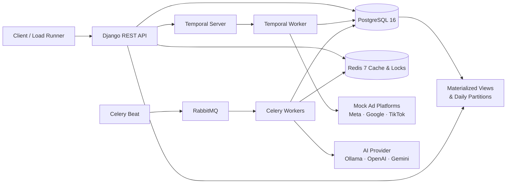

# AdOrchestrator

[](https://github.com/ShivanshHingve2804/adorchestrator/actions/workflows/ci.yml)
[](https://www.python.org/)
[](https://www.djangoproject.com/)
[](https://temporal.io/)
[](https://www.postgresql.org/)
[](LICENSE)

**Fault-tolerant multi-platform ad campaign orchestration, race-safe budget control, partitioned PostgreSQL analytics, and AI creative correlation.**

AdOrchestrator coordinates multi-step campaign launches across flaky ad platform APIs (Meta, Google, TikTok), prevents concurrent manual and automated budget races with two-layer Redis + PostgreSQL locking, materializes partitioned performance telemetry with sub-millisecond cached reporting, and correlates VLM-extracted creative traits against `CTR`, `CPA`, and `ROAS`.

---

## Verified Highlights

- **Durable Saga Orchestration ([`workflows/bulk_launch_workflow.py`](workflows/bulk_launch_workflow.py)):** Executes `validate -> upload -> create -> set_budget -> activate` per platform × creative inside Temporal workflows with exponential retries (`max=5`, backoff `2s -> 60s`), non-retryable validation boundaries (`InvalidMediaError`), and reverse-order compensating rollback across previously created deployments.
- **Chaos-Tested Recovery ([`docs/CHAOS_TEST_RESULTS.md`](docs/CHAOS_TEST_RESULTS.md)):** Live `SIGKILL` of the `temporal-worker` container mid-flight (`tests/chaos/chaos_test.py`) recovered cleanly on restart → `COMPLETED`, `['ACTIVE', 'ACTIVE', 'ACTIVE']`, `0` duplicate idempotency keys across 3 platform deployments.
- **Two-Layer Budget Concurrency Control ([`apps/budgets/services.py`](apps/budgets/services.py)):** Serializes concurrent budget mutations via an atomic Redis `SET NX EX` lease (Lua compare-and-delete release) followed by PostgreSQL `SELECT ... FOR UPDATE`, optimistic `version` increment, and immutable audit ledger logging. Proven in automated 20-thread concurrency stress tests (`1` winner, `19` `409 Conflict`s, `1` audit row) and live Celery auto-remediation races.
- **Partitioned Analytics & Anomaly Remediation ([`workers/tasks/analytics.py`](workers/tasks/analytics.py)):** UTC-day range-partitioned `AdEvent` storage (90-day retention + 30-day lookahead), `CONCURRENTLY` refreshed materialized views, 5-minute Redis read caching (`1.26 ms` cold MV read / `0.21 ms` warm cache across `25,000` seeded events; `0.19–0.38 ms` suite p95 vs `200 ms` target), and Celery Beat anomaly detection (`CPA_SPIKE > 1.5x`, `ROAS_DROP < 0.6x`).
- **Provider-Agnostic Creative AI ([`apps/creative_ai/`](apps/creative_ai/)):** Celery workers validate bounded media from public URLs, sample up to 5 video frames via bundled `ffmpeg`, extract structured traits via deployment-configured `ollama`, `openai`, or `gemini` endpoints, rank traits by `ROAS`, and generate measurement-grounded weekly summaries.
- **39 Automated Tests & CI/CD ([`.github/workflows/ci.yml`](.github/workflows/ci.yml)):** Covers models, idempotency, 20-thread races, Temporal retries/sagas, migration graph integrity, Celery Beat registration, Docker builds, Locust/k6 load tests, and a manual OIDC AWS ECS deployment workflow.

---

## Architecture



### Design Trade-offs

| Decision | Rationale |
|---|---|
| **Temporal for launches, Celery + RabbitMQ for analytics/AI** | Campaign publication spans minutes with multi-step compensation (`rollback_campaign`) where durable execution state prevents partial spend leaks. High-throughput cron refreshes, partition maintenance, and VLM calls fit lightweight Celery queues cleanly. |
| **Redis `SET NX` lease + PostgreSQL `SELECT FOR UPDATE`** | Failing fast in Redis (`HTTP 409`) prevents thundering-herd DB connection starvation during auto/manual races, while `SELECT ... FOR UPDATE` and optimistic `version` guarantee serializability even under Redis lock expiry edge cases. |
| **Decoupled UUID references on partitioned `AdEvent`** | Dropping 90-day-old partitions remains instantaneous and free of parent-table FK lock contention; `PerformanceSnapshot` upserts join back to live campaign/creative rows cleanly. |
| **Idempotency key format `{key}:{platform}:{creative_id}`** | Retrying `/bulk_launch/` reuses exact `PlatformDeployment` rows and Temporal `workflow_id` (`bulk-launch-{campaign_id}-{key}`), preventing duplicate ad spend across client/network retries. |

---

## Tech Stack

| Layer | Technologies |
|---|---|
| **API & Domain** | Python 3.12, Django 5.1, Django REST Framework |
| **Durable Orchestration** | Temporal (`temporalio`), custom chaos-injecting FastAPI platform simulators (`429`/`500`/`504`/partial failure) |
| **Async Workers & Broker** | Celery 5.4, Celery Beat (`DatabaseScheduler`), RabbitMQ 3 |
| **Storage & Locking** | PostgreSQL 16 (range partitioning + concurrent MVs), Redis 7 (cache + Lua-released distributed locks) |
| **Creative AI & Media** | Pillow, `imageio-ffmpeg`, REST adapters for Ollama, OpenAI, and Google Gemini |
| **Testing & DevOps** | Django test suite (39 tests), Ruff, Locust, k6, Docker Compose (10 services), GitHub Actions, AWS ECS OIDC workflow |

---

## Quick Start

### 1. Boot the 10-service stack

```bash
cp .env.example .env
docker compose up -d --build
docker compose exec api python manage.py migrate
```

| Service | Local URL |
|---|---|
| **Django REST API (Browsable)** | `http://localhost:8000/api/campaigns/` |
| **Temporal Web UI** | `http://localhost:8233` |
| **RabbitMQ Management UI** | `http://localhost:15672` (`guest` / `guest`) |
| **Mock Ad Platforms Docs** | `http://localhost:8090/docs` |

### 2. Seed sample campaigns & analytics events

```bash
docker compose exec api python scripts/seed_campaigns.py
docker compose exec api python scripts/seed_ad_events.py --count 25000
```

> `seed_ad_events.py` defaults to `5,000,000` events (`--batch-size 5000`); pass `--count` to size local runs.

### 3. Run checks, tests, and chaos verification

```bash
# Run full 39-test suite (models, APIs, 20-thread concurrency, Temporal sagas, latency)
docker compose exec api python manage.py test --verbosity=2

# Trigger live Temporal worker SIGKILL & crash recovery test
python tests/chaos/chaos_test.py

# Equivalent Makefile targets
make up && make migrate && make test && make chaos-integration
```

---

## API Overview

Full request/response payloads and status codes are documented in **[`docs/API.md`](docs/API.md)**.

| Domain | Endpoints |
|---|---|
| **Campaigns & Creatives** | `GET/POST /api/campaigns/`, `GET/PUT/PATCH /api/campaigns/{id}/`, `GET/POST /api/campaigns/{id}/creatives/` |
| **Durable Bulk Launch** | `POST /api/campaigns/{id}/bulk_launch/`, `GET /api/campaigns/{id}/launch-status/` |
| **Budget Locking & Audit** | `POST /api/budgets/campaigns/{id}/adjust-budget/`, `GET /api/budgets/campaigns/{id}/budget-history/` |
| **Analytics & Alerts** | `GET /api/analytics/campaigns/{id}/report/?days=7`, `GET /api/analytics/alerts/`, `POST /api/analytics/alerts/{id}/acknowledge/` |
| **Creative AI** | `POST /api/creative-ai/creatives/{id}/analyze/`, `GET /api/creative-ai/creatives/{id}/features/`, `GET /api/creative-ai/summaries/latest/` |

---

## Load Testing, Production & AI Configuration

- **Load Profiles:** Run [`tests/load/locustfile.py`](tests/load/locustfile.py) (`make loadtest`) or [`tests/load/k6_script.js`](tests/load/k6_script.js) to exercise concurrent budget mutations and idempotent bulk launches.
- **AI Providers:** Configure `AI_PROVIDER` (`ollama` | `openai` | `gemini`), `AI_BASE_URL`, `AI_VISION_MODEL`, `AI_TEXT_MODEL`, and optional `AI_API_KEY`. No model weights or keys are bundled or needed to pass CI.
- **Production Stack & AWS ECS:** See [`docker-compose.prod.yml`](docker-compose.prod.yml), [`.env.prod.example`](.env.prod.example), and [`infra/aws/DEPLOYMENT.md`](infra/aws/DEPLOYMENT.md) for non-root containers, enforced API auth, loopback TLS binding, and OIDC Fargate deployment via [`.github/workflows/deploy-aws.yml`](.github/workflows/deploy-aws.yml).

---

## Further Reading

- **[`docs/ARCHITECTURE.md`](docs/ARCHITECTURE.md)** — Workflow topology, locking mechanics, partition lifecycle, Celery Beat schedule
- **[`docs/API.md`](docs/API.md)** — Endpoint reference, payloads, idempotency, and conflict semantics
- **[`docs/CHAOS_TEST_RESULTS.md`](docs/CHAOS_TEST_RESULTS.md)** — Concurrency stress tests and live Temporal worker `SIGKILL` recovery evidence
- **[`docs/LATENCY_BENCHMARKS.md`](docs/LATENCY_BENCHMARKS.md)** — Cold MV and warm Redis cache timings across 25k seeded events and test suite p95
- **[`infra/aws/DEPLOYMENT.md`](infra/aws/DEPLOYMENT.md)** — AWS ECS Fargate OIDC deployment prerequisites
