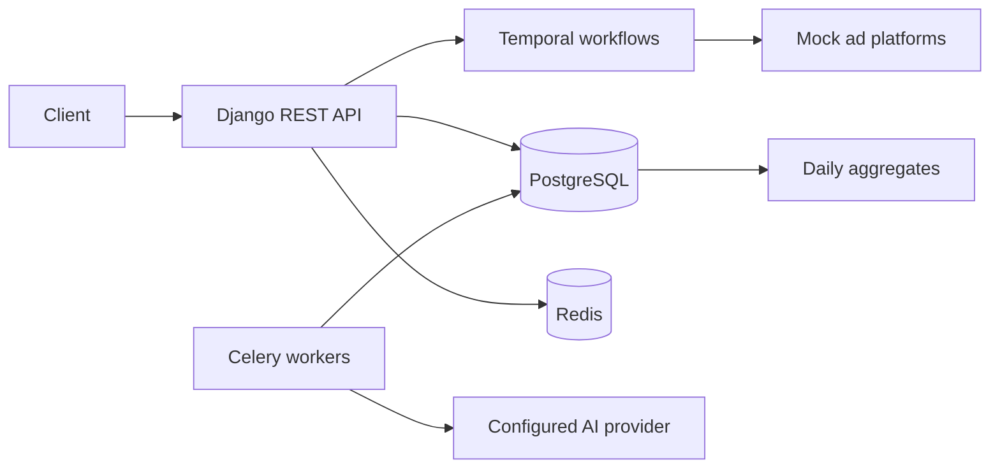

# AdOrchestrator

Fault-tolerant ad campaign orchestration with race-safe budget management, PostgreSQL analytics, alerting, and provider-configurable creative analysis.

## Architecture



## Features

- Durable bulk campaign launch with activity retries and saga rollback.
- Idempotent campaign and platform deployment requests.
- Budget changes guarded by a Redis lease and PostgreSQL row lock.
- Daily event partitions, concurrently refreshable materialized analytics, cached reporting, and deduplicated alerts.
- Image and sampled-video creative features, performance correlations, and weekly summaries through a deployment-configured provider.
- Locust/k6 load scripts, a Temporal worker recovery exercise, and GitHub Actions checks.

## Quick start

```bash
cp .env.example .env
docker compose up -d --build
docker compose exec api python manage.py migrate
docker compose exec api python scripts/seed_campaigns.py
docker compose exec api python scripts/seed_ad_events.py --count 100000
docker compose exec api python manage.py test --verbosity=2
```

The event seed script defaults to 5,000,000 rows. Use a smaller count for a local smoke run. Run `make up`, `make migrate`, `make test`, `make loadtest`, and `make chaos-integration` for the corresponding shortcuts.

## Reports

- [Phase 1 — Django foundation](reports/phase_1_report.md)
- [Phase 2 — Temporal workflows](reports/phase_2_report.md)
- [Phase 3 — Distributed budget locking](reports/phase_3_report.md)
- [Phase 4 — Analytics and alerting](reports/phase_4_report.md)
- [Phase 5 — Creative AI](reports/phase_5_report.md)
- [Phase 6 — Hardening and showcase](reports/phase_6_report.md)

Supporting documents: [architecture](docs/ARCHITECTURE.md), [latency benchmark](docs/LATENCY_BENCHMARKS.md), and [chaos results](docs/CHAOS_TEST_RESULTS.md).

## AI provider configuration

Set `AI_PROVIDER`, `AI_BASE_URL`, `AI_VISION_MODEL`, `AI_TEXT_MODEL`, and `AI_API_KEY` in the environment. The provider and model identifiers are deployment configuration. The app does not bundle a model or require a provider key for its test suite. The runtime image bundles the frame extraction utility used for video analysis.

## Production settings

Copy `.env.prod.example` to `.env.prod`, replace the secret placeholders, then use `docker-compose.prod.yml`. The production settings require an explicit `SECRET_KEY` and `ALLOWED_HOSTS`, enable HTTPS security headers, and require an authenticated API session or Basic Auth. The supplied production Compose stack is a single-host deployment template; cloud resources and live worker recovery require environment-specific credentials and validation.
