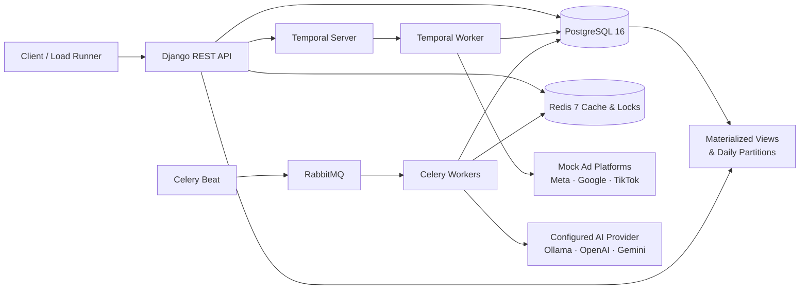

# AdOrchestrator Architecture

## Request and Data Flow

---

## Durable Workflow Orchestration (Temporal)

Bulk launches execute inside `BulkCampaignLaunchWorkflow` (`workflows/bulk_launch_workflow.py`) on task queue `ad-orchestrator-queue` with workflow ID `bulk-launch-{campaign_id}-{idempotency_key}`:

1. **Mark Campaign Launching** — updates campaign status to `LAUNCHING`.
2. **Per-Platform × Creative Pipeline** (`{idempotency_key}:{platform}:{creative_id}`):
   - `validate_creative` (non-retryable on `InvalidMediaError`)
   - `upload_media`
   - `create_campaign` (registers deployment ID for compensation)
   - `set_budget`
   - `activate_campaign`
3. **Resilience & Saga Compensation**:
   - Transient failures (`429 Too Many Requests`, `500`, `504` timeouts injected by `mock_platforms`) retry with exponential backoff (`initial=2s`, `coeff=2.0`, `max=60s`, up to 5 attempts).
   - Hard failures mark the failing `PlatformDeployment` as `FAILED` and execute `rollback_campaign` in reverse order across every previously created platform deployment (up to 10 retry attempts).
   - Worker `SIGKILL` crashes resume mid-flight from Temporal event history without duplicating external writes or `PlatformDeployment` rows.

---

## Two-Layer Budget Concurrency Control

Concurrent manual edits and Celery anomaly auto-adjustments serialize safely inside `BudgetService.adjust_budget()` (`apps/budgets/services.py`):

1. **Fast Distributed Lease (Redis):** Atomic `SET budget_lock:{campaign_id} <token> NX EX 10`. Contending writers fail fast with `ConflictError` → HTTP `409 Conflict` rather than piling up database lock waits.
2. **Transactional Row Lock (PostgreSQL):** `Campaign.objects.select_for_update().get(pk=campaign_id)` inside `transaction.atomic()`, paired with optimistic `version = F("version") + 1`.
3. **Safe Lock Release:** A Redis Lua script compares the stored token before deleting the key so an expiring lease never deletes another caller's lock.
4. **Idempotency & Auditability:** Every mutation records an immutable `BudgetAdjustment` row with `original_budget`, `new_budget`, `budget_change`, `percent_delta`, `trigger_type`, and `lock_token`.

---

## Partitioned Analytics Engine & Retention

- **`analytics_ad_event`**: PostgreSQL `RANGE (event_time)` partitioned table with one partition per UTC day (plus a default partition). Migrations pre-create 90 historical days and 30 days ahead. Event rows store raw UUID references to campaigns and creatives instead of foreign keys so partition drops remain lock-free and independent of parent lifecycle.
- **`analytics_mv_campaign_daily_perf`**: Aggregated impressions, clicks, conversions, spend, revenue, `CTR`, `CPA`, and `ROAS` grouped by campaign, creative, platform, and UTC day. Indexed uniquely for zero-downtime `REFRESH MATERIALIZED VIEW CONCURRENTLY`.
- **Snapshot & Read Cache**: `ReportingService.get_campaign_report()` reads from the materialized view and caches JSON responses in Redis for 300 seconds (`report:v1:{campaign_id}:{days}`). `PerformanceSnapshot` stores upserted daily metrics for downstream tasks.

---

## Background Jobs (Celery + RabbitMQ)

`Celery Beat` (`workers/celery_app.py`) drives four scheduled maintenance and analytics pipelines:

| Schedule | Task | Responsibility |
|---|---|---|
| Every 15 min | `refresh_materialized_views` | Concurrently refreshes `analytics_mv_campaign_daily_perf` and upserts `PerformanceSnapshot`. |
| Every 15 min | `detect_anomalies` | Compares latest day vs. 7-day baseline; creates deduplicated `CPA_SPIKE` (`> 1.5x`) and `ROAS_DROP` (`< 0.6x`) alerts and triggers budget cuts (`0.70x` / `0.80x`) via `BudgetService` with retry on `ConflictError`. |
| Every 24 hrs | `maintain_event_partitions` | Creates daily partitions 32 days ahead and drops partitions older than 90 days. |
| Every 7 days | `generate_weekly_summary` | Joins creative features with daily performance and stores a grounded LLM summary. |

---

## Creative AI & Trait Correlation

1. `workers/tasks/creative_ai.py` downloads bounded media strictly from public HTTP(S) endpoints (`apps/creative_ai/extractor.py`), validates images, or samples up to 5 video frames via bundled `ffmpeg`.
2. Visual traits (`hook_type`, `visual_style`, `cta_present`, etc.) are extracted via deployment-configured VLM endpoints (`AI_PROVIDER`, `AI_BASE_URL`, `AI_VISION_MODEL`) and stored with provider/model metadata in `CreativeFeature`.
3. `apps/creative_ai/correlator.py` joins `CreativeFeature` rows against `analytics_mv_campaign_daily_perf` to rank creative attributes by `CTR`, `CPA`, and `ROAS`.
4. `summary_generator.py` passes strictly aggregated measurements to the text model (`AI_TEXT_MODEL`) with explicit instructions not to extrapolate unmeasured numbers.

---

## API & Production Hardening

- **Full Endpoint Documentation:** See [`docs/API.md`](API.md).
- **Production Settings (`adorchestrator.settings.prod`):** Requires explicit `SECRET_KEY` and `ALLOWED_HOSTS`, enables HTTPS/HSTS security headers, runs containers as non-root user `app`, and enforces authenticated DRF access (`SessionAuthentication` + `BasicAuthentication`). `docker-compose.prod.yml` binds HTTP port `8000` to `127.0.0.1` for TLS reverse-proxy termination.
