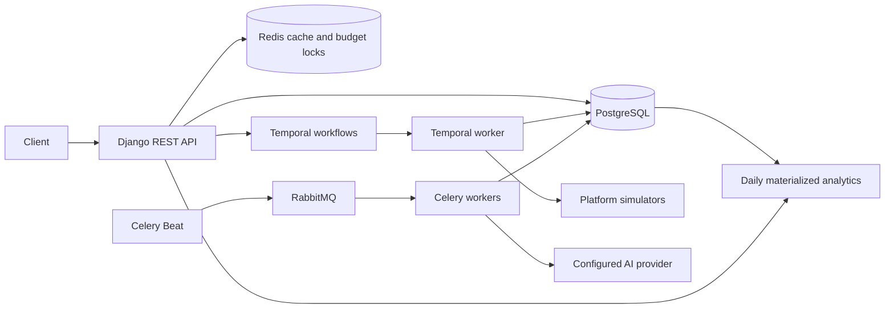

# AdOrchestrator Architecture

## Request and data flow

## Analytics and retention

`analytics_ad_event` is a PostgreSQL range-partitioned table with one UTC-day partition. The migration creates a 90-day history window and 30 days ahead, plus a default partition. Celery Beat advances the window and removes dated partitions older than 90 days. Event rows keep UUID references to campaigns and creatives without database foreign keys so retention and PostgreSQL partition maintenance do not depend on parent-row lifetime.

`analytics_mv_campaign_daily_perf` aggregates counts, spend, revenue, CTR, CPA, and ROAS by campaign, creative, platform, and UTC day. A unique index permits concurrent refresh. The reporting API reads the materialized view and caches responses in Redis for five minutes. `PerformanceSnapshot` stores refreshable daily copies for downstream tasks.

## Background jobs

Celery Beat refreshes aggregates and snapshots every 15 minutes, evaluates CPA and ROAS anomalies every 15 minutes, advances event partitions daily, and requests a weekly creative summary. Alert dedupe keys make repeated anomaly runs idempotent. CPA and ROAS actions route budget changes through the Phase 3 Redis plus PostgreSQL locking service.

## Creative analysis

Creative analysis is queued through Celery. The worker fetches bounded image/video media from public HTTP(S) hosts, samples up to five video frames with the bundled `ffmpeg` binary, and sends the frames to a configured AI provider. Provider and model identifiers come from deployment environment variables. Extracted features are stored with provider/model metadata. Correlations join those features to daily performance; weekly summaries ask the configured text provider to describe only measured values.

## API routes

- `GET /api/analytics/campaigns/{campaign_id}/report/?days=7`
- `GET /api/analytics/alerts/`
- `POST /api/analytics/alerts/{alert_id}/acknowledge/`
- `POST /api/creative-ai/creatives/{creative_id}/analyze/`
- `GET /api/creative-ai/creatives/{creative_id}/features/`
- `GET /api/creative-ai/summaries/latest/`
- Budget adjustment routes are documented in [the Phase 3 report](../reports/phase_3_report.md).

## Production controls

`adorchestrator.settings.prod` requires an explicit secret key and host list, enables HTTPS/HSTS settings, and requires authenticated REST requests. The production Compose file binds the API to loopback by default so a TLS reverse proxy can terminate public HTTPS. Copy `.env.prod.example` to `.env.prod`, replace every placeholder, and use managed secret storage before deployment.
